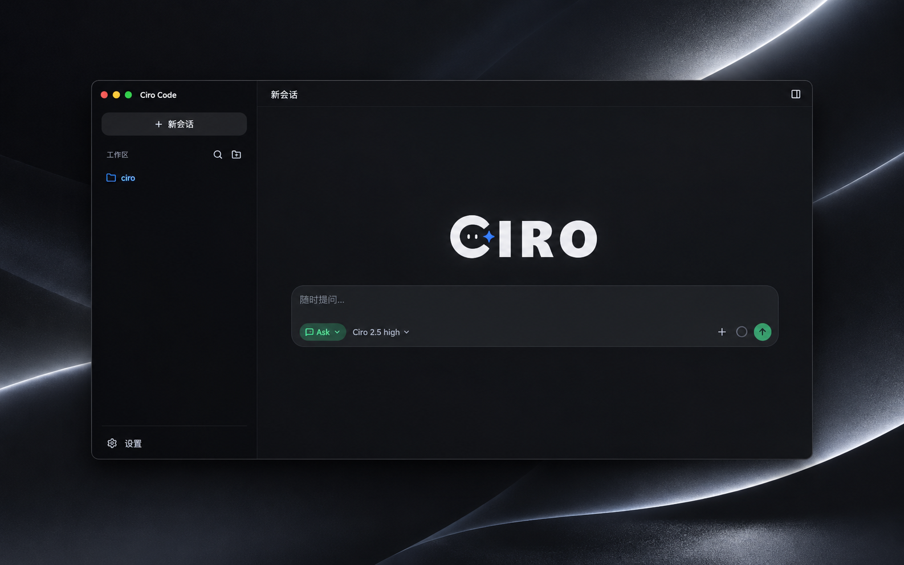

<div align="center">

<picture>
  <source media="(prefers-color-scheme: dark)" srcset="assets/readme/logo-dark.png" />
  
</picture>

**Local-first coding agent with a Web workbench.**

Modes, permissions, and diffs you can see. Inference goes only to endpoints you configure.

[](https://www.npmjs.com/package/@ciro-code/code)
[](./LICENSE)
[](https://nodejs.org)

[Docs](https://raysolid.github.io/ciro-code/docs/en/) ·
[Website](https://raysolid.github.io/ciro-code/) ·
[npm](https://www.npmjs.com/package/@ciro-code/code) ·
[Security](./SECURITY.md)

**English** | [简体中文](./README.zh-CN.md)

</div>

---

<div align="center">
  
</div>

## Install

Node.js **20+**. Windows (pwsh recommended), macOS, or Linux.

```bash
npm install -g @ciro-code/code

ciro web                 # → http://127.0.0.1:5280
ciro web --mock          # UI without an API key
ciro web -w . --mode ask # open this repo read-only
```

Set `DEEPSEEK_API_KEY` / `OPENAI_API_KEY`, or add a provider in **Settings → Models**.

## Modes

`Ask` · `Plan` · `Agent` · `Debug` — switch via the top bar, `Shift+Tab`, or `/mode`.

See [Modes](https://raysolid.github.io/ciro-code/docs/en/guides/modes/) and [Quickstart](https://raysolid.github.io/ciro-code/docs/en/getting-started/quickstart/).

## Build from source

```bash
git clone https://github.com/Raysolid/ciro-code.git
cd ciro-code
pnpm install && pnpm run build
pnpm run dev:web:mock
```

Requires pnpm 9+. See [CONTRIBUTING.md](./CONTRIBUTING.md).

## Contributing

[Issues](https://github.com/Raysolid/ciro-code/issues) · [CONTRIBUTING.md](./CONTRIBUTING.md) · security via [Advisories](https://github.com/Raysolid/ciro-code/security/advisories/new) ([SECURITY.md](./SECURITY.md))

## License

[MIT](./LICENSE)
