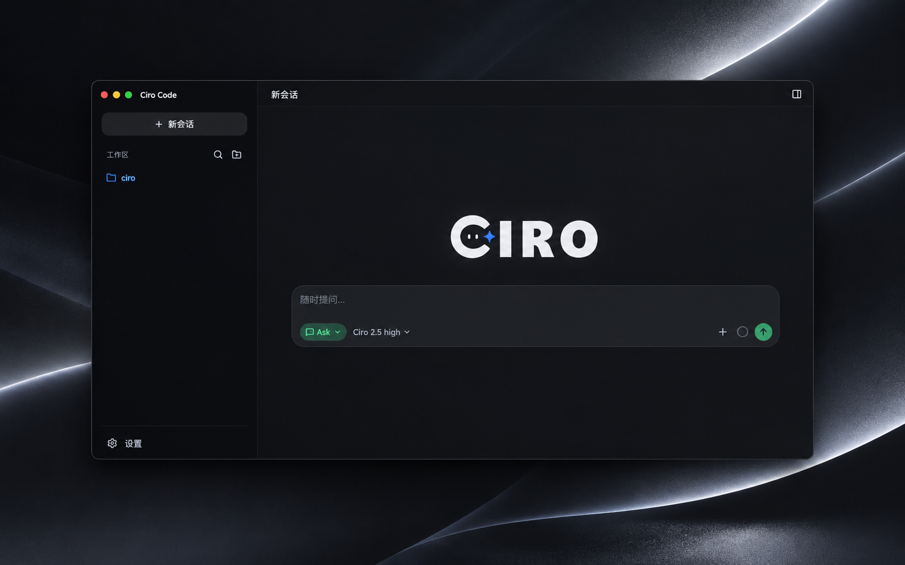

<div align="center">

<picture>
  <source media="(prefers-color-scheme: dark)" srcset="assets/readme/logo-dark.png" />
  
</picture>

**本地优先的 Coding Agent，自带 Web 工作台。**

Ask · Plan · Agent · Debug · 可见权限 · 可审阅的 diff。  
你的代码只发往 *你自己配置* 的模型端点 — 没有 Ciro 云代理。

[](https://www.npmjs.com/package/@ciro-code/code)
[](./LICENSE)
[](https://nodejs.org)

[文档](https://raysolid.github.io/ciro-code/docs/zh-cn/) ·
[官网](https://raysolid.github.io/ciro-code/) ·
[npm](https://www.npmjs.com/package/@ciro-code/code) ·
[安全](./SECURITY.md)

[English](./README.md) | **简体中文**

</div>

---

<div align="center">
  
</div>

## 快速开始

**环境：** Node.js **20+** · Windows（推荐 pwsh）、macOS 或 Linux。

```bash
npm install -g @ciro-code/code
# 等价包：npm install -g @ciro-code/cli

ciro web                    # → http://127.0.0.1:3080
ciro web --mock             # 无 API Key 先逛界面
ciro web -w . --mode ask    # 指定工作区，只读启动
```

设置 `DEEPSEEK_API_KEY` / `OPENAI_API_KEY`，或在 **设置 → 模型** 中添加 Provider。

更多：[快速开始](https://raysolid.github.io/ciro-code/docs/zh-cn/getting-started/quickstart/) · [连接模型](https://raysolid.github.io/ciro-code/docs/zh-cn/getting-started/first-provider/) · [排障](https://raysolid.github.io/ciro-code/docs/zh-cn/guides/troubleshooting/)

## 从源码构建

本仓库是 **开源 Kernel**（策略、会话、Pi/Mock 运行时、HTTP+SSE API、CLI、`ext-git`）。Web UI 与官方四模式 Profile 以 npm 产物分发。

```bash
git clone https://github.com/Raysolid/ciro-code.git
cd ciro-code
pnpm install
pnpm run build

pnpm run dev:web:mock   # Mock（无需 Key）
pnpm run dev:web        # 真实模型
pnpm test
```

需要 Node.js 20+ 与 pnpm 9+。详见 [CONTRIBUTING.md](./CONTRIBUTING.md) · [开源边界](https://raysolid.github.io/ciro-code/docs/zh-cn/open-core/what-is-open/)

## 文档

| | |
| :-- | :-- |
| 入门 | [总览](https://raysolid.github.io/ciro-code/docs/zh-cn/getting-started/overview/) · [安装](https://raysolid.github.io/ciro-code/docs/zh-cn/getting-started/install/) · [快速开始](https://raysolid.github.io/ciro-code/docs/zh-cn/getting-started/quickstart/) |
| 指南 | [模式](https://raysolid.github.io/ciro-code/docs/zh-cn/guides/modes/) · [权限](https://raysolid.github.io/ciro-code/docs/zh-cn/guides/permissions/) · [MCP](https://raysolid.github.io/ciro-code/docs/zh-cn/guides/mcp/) · [Packs](https://raysolid.github.io/ciro-code/docs/zh-cn/guides/packs/) |
| 参考 | [CLI](https://raysolid.github.io/ciro-code/docs/zh-cn/reference/cli/) · [配置](https://raysolid.github.io/ciro-code/docs/zh-cn/reference/config/) |
| Agent / CI | [`AGENTS.md`](./AGENTS.md) |

## 贡献与许可

问题与建议：[GitHub Issues](https://github.com/Raysolid/ciro-code/issues)。  
Kernel / CLI 改动：[CONTRIBUTING.md](./CONTRIBUTING.md)。  
安全漏洞请**私下**通过 [Security advisories](https://github.com/Raysolid/ciro-code/security/advisories/new) 报告 — 见 [SECURITY.md](./SECURITY.md)。

Kernel、CLI 与官方 Git Pack：[MIT](./LICENSE)。Web UI 与官方 Profile 以 npm 构建产物分发。
