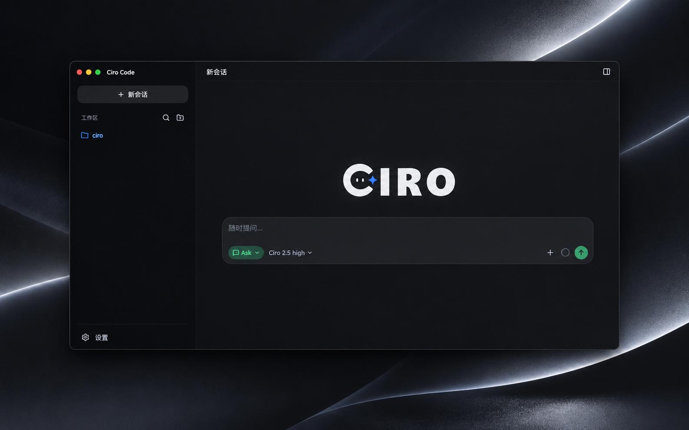

<div align="center">

<picture>
  <source media="(prefers-color-scheme: dark)" srcset="assets/readme/logo-dark.png" />
  
</picture>

**本地优先的 Coding Agent，自带 Web 工作台。**

模式、权限与 Diff 可见可审。推理只发往你配置的模型端点。

[](https://www.npmjs.com/package/@ciro-code/code)
[](./LICENSE)
[](https://nodejs.org)

[文档](https://raysolid.github.io/ciro-code/docs/zh-cn/) ·
[官网](https://raysolid.github.io/ciro-code/) ·
[npm](https://www.npmjs.com/package/@ciro-code/code) ·
[安全](./SECURITY.md)

[English](./README.md) | **简体中文**

</div>

---

<div align="center">
  
</div>

## 安装

需要 Node.js **20+**。支持 Windows（推荐 pwsh）、macOS、Linux。

```bash
npm install -g @ciro-code/code

ciro web                 # → http://127.0.0.1:5280
ciro web --mock          # 无 API Key 先逛界面
ciro web -w . --mode ask # 只读打开当前仓库
```

设置 `DEEPSEEK_API_KEY` / `OPENAI_API_KEY`，或在 **设置 → 模型** 添加 Provider。

## 工作模式

`Ask` · `Plan` · `Agent` · `Debug` — 顶栏、`Shift+Tab` 或 `/mode` 切换。

详见 [工作模式](https://raysolid.github.io/ciro-code/docs/zh-cn/guides/modes/) 与 [快速开始](https://raysolid.github.io/ciro-code/docs/zh-cn/getting-started/quickstart/)。

## 从源码构建

```bash
git clone https://github.com/Raysolid/ciro-code.git
cd ciro-code
pnpm install && pnpm run build
pnpm run dev:web:mock
```

需要 pnpm 9+。见 [CONTRIBUTING.md](./CONTRIBUTING.md)。

## 贡献

[Issues](https://github.com/Raysolid/ciro-code/issues) · [CONTRIBUTING.md](./CONTRIBUTING.md) · 安全漏洞走 [Advisories](https://github.com/Raysolid/ciro-code/security/advisories/new)（[SECURITY.md](./SECURITY.md)）

## 许可

[MIT](./LICENSE)
