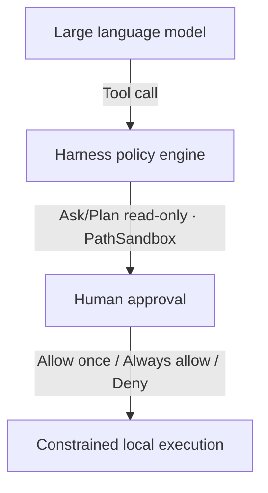

How Ciro keeps work on your machine: path sandbox, shell allowlist, approvals, and where keys live.

---

## Core guarantees

| Guarantee | How it lands |
|-----------|--------------|
| **No cloud proxy** | Workspace files are never mirrored to a Ciro-hosted cloud. |
| **Keys stay local** | API keys live only under `~/.ciro/credentials/`. |
| **Direct inference** | LLM calls go straight to the endpoints you configure. |
| **Auditable open kernel** | Core Kernel and CLI are MIT-licensed; sandbox logic is inspectable. |

---

## Defense in depth

### 1. PathSandbox
- `read` / `write` / `edit` stay inside the active workspace root by default;
- Traversal via `../` to system paths (`/etc/passwd`, `~/.ssh/`) is blocked by the Kernel.

### 2. Shell allowlist
- Harmless commands from the preset or `.ciro/config.yaml` (e.g. `git status`, `npm test`) run automatically;
- Destructive commands (`rm -rf`, disk wipes, unaudited privilege escalation) are blocked;
- **Prompt-injection exfil defense**: unauthorized `curl`, `wget`, and PowerShell network cmdlets (`Invoke-WebRequest`, `Invoke-RestMethod`) are intercepted.

### 3. Human approval
Operations outside the allowlist pause and show an approval modal:
- **Allow once**: this single call;
- **Always allow**: add the pattern to the workspace dynamic allowlist;
- **Deny**: abort the tool call; the model gets a policy rejection and can try a safer path.

---

## Credentials

1. **Local encrypted storage**: workbench keys under `~/.ciro/credentials/`; provider metadata without plaintext keys in `~/.ciro/providers.json`;
2. **Keep secrets out of Git**: never commit live `.env` files, credentialed configs, or session transcripts;
3. **Masked diagnostics**: `ciro doctor` and similar commands mask recognized API key patterns.

---

## Vulnerability disclosure

- **Channel**: do not open public Issues for security bugs; use GitHub [Security Advisories](https://github.com/Raysolid/ciro-code/security/advisories/new);
- **Response**: acknowledge within 48 hours;
- **Patches**: ship against the latest `@ciro-code/code` npm releases.

---

## Next steps

- [Permissions & config](/guides/permissions/)
- [Workspace & sessions](/guides/workspace-session/)
- [Open-source scope](/open-core/what-is-open/)
