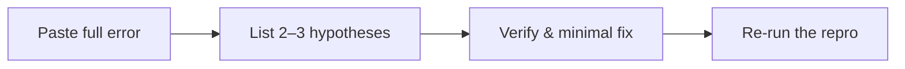

Failing tests, flaky exceptions, or opaque stacks often tempt “just fix it” prompts—and sprawling refactors. **Debug mode** pushes hypotheses first, then verification, then a minimal change near the reproduction path.

---

## Four steps



### 1. Switch to Debug
Choose **Debug** in the top bar, or run `/mode debug`.

### 2. Provide the failure and repro command

Copy this prompt and swap in your command and stack:

```text
The command npm test -- user-service failed.

Reproduction command:
npm test -- tests/services/user.test.ts -t "should handle token expiry"

Complete terminal output:
TypeError: Cannot read properties of undefined (reading 'refreshToken')
    at AuthService.verifyToken (src/services/auth.ts:42:18)
    at UserService.getUser (src/services/user.ts:15:31)

Requirements:
1. List 2–3 hypotheses that could explain this failure;
2. Confirm the root cause and apply the minimal fix;
3. No unrelated refactoring—only change root-cause code;
4. Re-run the reproduction command until the test passes.
```

### 3. Review hypotheses
Before editing, the agent should reason out loud, for example:
- **Hypothesis 1**: Token is malformed or cleared early, so the payload is undefined;
- **Hypothesis 2**: Mock fixtures omit `refreshToken`;
- **Check**: Read `src/services/auth.ts:42` (and setup) to prove which holds.

### 4. Review the Diff and clean debug noise
In **Changes**:
- [ ] Diff tightly scoped (often a few lines of guards or logic)?
- [ ] Temporary `console.log` removed?
- [ ] Same reproduction command passes?

---

## Common mistakes

- ❌ **Only “the test failed, fix it”**: without a repro command and full stack, the agent guesses and edits unrelated files;
- ❌ **Opportunistic refactoring**: keep the change on the defect; style rewrites hide regressions;
- ❌ **No regression coverage**: if the edge case was untested, ask for a focused assertion before closing.

---

## Next steps

- Day-to-day delivery: [Implement and Verify](/workflows/implement-and-verify/)
- Env / port issues: [Troubleshooting](/guides/troubleshooting/)
- Mode design: [Modes](/guides/modes/)
