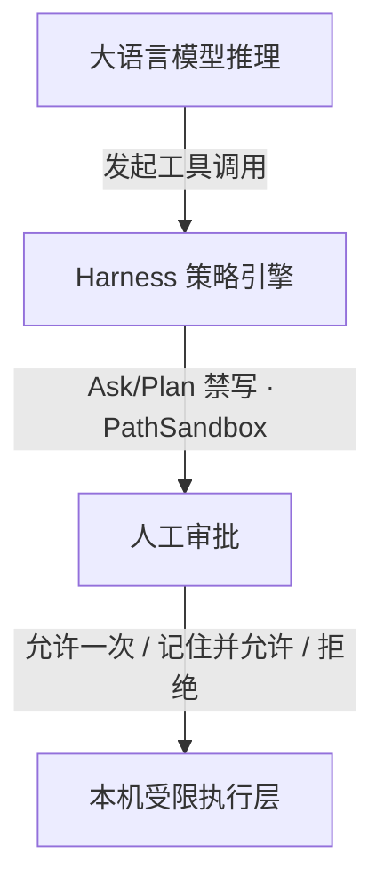

本页说明工作如何留在本机：路径沙箱、Shell 白名单、审批弹窗，以及密钥存放位置。

---

## 核心安全承诺

| 承诺 | 落地方式 |
|------|----------|
| **零云端代理** | 不把源码或仓库镜像上传到 Ciro 托管云，无中间人服务器。 |
| **密钥仅存本机** | API Key 只保存在 `~/.ciro/credentials/`，不离机同步。 |
| **推理直连端点** | 请求只发往你在设置中指定的官方或自建端点。 |
| **可审计的开源内核** | Core Kernel 与 CLI 基于 MIT 开源，沙箱与工具调度逻辑可查。 |

---

## 多层防护

### 1. 路径沙箱（PathSandbox）
- `read` / `write` / `edit` 默认锚定在当前工作区根目录；
- 经 `../` 越界访问系统敏感路径（如 `/etc/passwd`、`~/.ssh/`）会被 Kernel 拦截。

### 2. Shell 白名单
- 自动放行预设或你在 `.ciro/config.yaml` 中配置的无害命令（如 `git status`、`npm test`）；
- 拦截高危命令（如 `rm -rf`、格式化磁盘、未审计的提权）；
- **防提示词注入外发**：拦截未经授权的 `curl`、`wget` 以及 PowerShell 网络 Cmdlet（如 `Invoke-WebRequest`）。

### 3. 人工审批
白名单外的命令或边界文件修改会暂停任务并弹出审批：
- **允许一次**：仅本次调用；
- **记住并允许**：写入当前工作区动态白名单；
- **拒绝**：终止该工具调用，模型收到拒绝反馈后可改走合规路径。

---

## 凭据管理

1. **本地加密存储**：工作台录入的 Key 在 `~/.ciro/credentials/`；不含明文 Key 的 Provider 元数据在 `~/.ciro/providers.json`；
2. **勿提交到 Git**：不要把含真实 Key 的 `.env`、配置或会话日志推到公开仓库；
3. **日志打码**：`ciro doctor` 等诊断输出会对已知格式的 API Key 做掩码。

---

## 漏洞披露

- **渠道**：勿在公开 Issue 报安全漏洞，请通过 GitHub [Security Advisories](https://github.com/Raysolid/ciro-code/security/advisories/new) 私下披露；
- **响应**：维护团队 48 小时内确认并评估影响；
- **修复**：以最新发布的 `@ciro-code/code` npm 包为准。

---

## 接下来

- [权限与配置说明](/guides/permissions/)
- [工作区与会话路径](/guides/workspace-session/)
- [开源范围说明](/open-core/what-is-open/)
